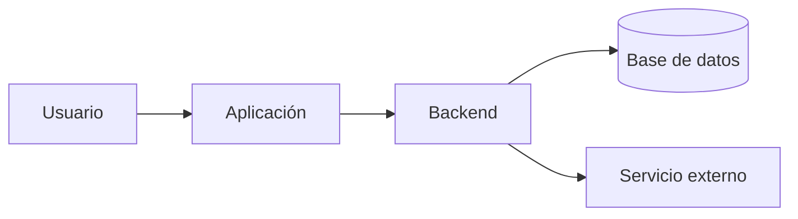

# Nombre del proyecto

[← Volver al portfolio técnico](../README.md)

Resumen de una frase centrado en el problema resuelto.

| | |
| --- | --- |
| **Situación** | Producción, piloto, producto privado o archivado |
| **Rol** | Responsabilidad real |
| **Stack** | Tecnologías principales |
| **Integraciones** | Proveedores o sistemas externos relevantes |
| **Código** | Público o privado |

## Problema

Qué necesitaba el usuario y por qué no era un problema trivial.

## Arquitectura

## Decisiones técnicas

### Decisión

Contexto, alternativa elegida y motivo. Documentar el trade-off, no una lista de tecnologías.

## Retos y soluciones

| Reto | Solución |
| --- | --- |
| Problema técnico concreto | Mecanismo utilizado y por qué |

## Resultado

Impacto verificable o alcance entregado. Si no existe una métrica pública, describir la capacidad sin inventarla.

## Límites de esta documentación

Indicar qué se omite por privacidad: código propietario, secretos, lógica sensible, datos de clientes o detalles de infraestructura.
