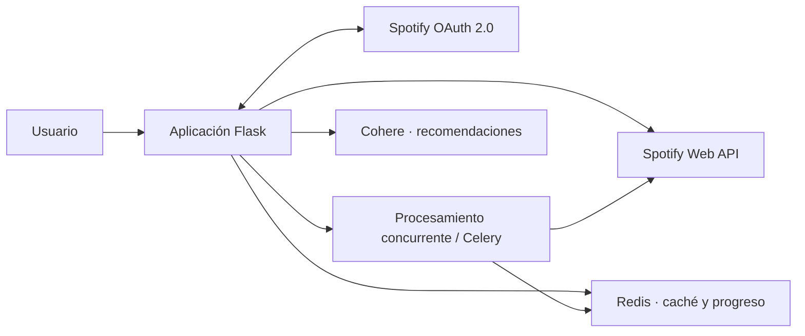

# BeatList

[← Volver al portfolio técnico](../README.md)

Aplicación para analizar y gestionar playlists de Spotify con una experiencia orientada a bibliotecas grandes.

| | |
| --- | --- |
| **Situación** | Aprobada por Spotify y utilizada desde varios países |
| **Rol** | Diseño de producto, arquitectura y dirección técnica de extremo a extremo |
| **Stack** | Flask, Spotify Web API, OAuth 2.0, Redis, Celery y Cohere |
| **Integraciones** | Spotify y Cohere |
| **Código** | Privado |

## Problema

La API de Spotify ofrece los datos, pero una herramienta útil debe manejar autorización, tokens que caducan, paginación, límites de uso y playlists que cambian. En colecciones grandes, volver a descargar y recalcular todo en cada visita degrada tanto la experiencia como el consumo de API.

## Arquitectura

## Decisiones técnicas

### OAuth y renovación como parte del dominio

El acceso a Spotify se encapsula para detectar caducidad y renovar credenciales cuando corresponde. Los errores de autorización se distinguen de fallos temporales o límites de la API para que la recuperación sea coherente.

### Caché vinculada al snapshot

Spotify asigna un `snapshot_id` a la versión de una playlist. La caché usa usuario, playlist y snapshot como identidad: si la playlist cambia, el dato anterior deja de ser válido sin depender únicamente de un tiempo arbitrario.

### Dos modos de procesamiento

El análisis puede ejecutarse con concurrencia local o delegarse a Celery. La ruta ligera reduce infraestructura en despliegues pequeños; la cola permite desacoplar trabajos largos cuando el volumen lo exige.

### Progreso visible

Los trabajos extensos publican su avance en Redis. El frontend puede informar del estado sin mantener una petición HTTP abierta durante todo el análisis.

### Recomendaciones separadas del dato original

La capa de recomendación puede usar Cohere, pero no modifica ni sustituye los metadatos obtenidos de Spotify. Los datos del proveedor y las inferencias permanecen diferenciados.

## Retos y soluciones

| Reto | Solución |
| --- | --- |
| Evitar análisis obsoletos cuando cambia una playlist | Invalidación natural mediante `snapshot_id` |
| Procesar colecciones grandes sin bloquear la interfaz | Concurrencia, tareas asíncronas y seguimiento de progreso |
| Recuperarse de tokens vencidos | Renovación controlada y tratamiento específico de autorización |
| Respetar límites del proveedor | Caché, paginación y manejo de respuestas de rate limit |
| Incorporar recomendaciones sin alterar la fuente | Capa separada sobre los datos normalizados de Spotify |

## Resultado

BeatList fue aprobada por Spotify y permite explorar, analizar y gestionar playlists sin convertir cada interacción en una descarga completa. La arquitectura prioriza el uso responsable de la API y una respuesta estable ante bibliotecas grandes.

## Límites de esta documentación

No se publican credenciales OAuth, identificadores de usuarios, datos de escucha, algoritmos de recomendación, límites internos ni código fuente. La aprobación indicada corresponde al estado comunicado por Spotify para la aplicación; no implica afiliación.
