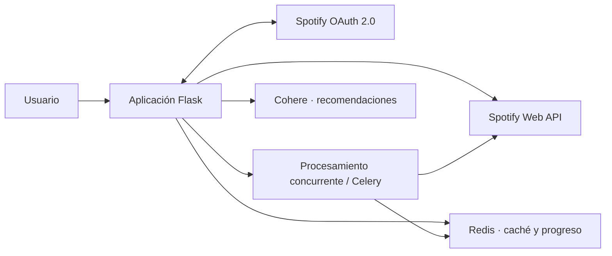

# BeatList

[← Volver al portfolio técnico](../README.md)

Aplicación para analizar y gestionar playlists de Spotify con una experiencia orientada a bibliotecas grandes.

| | |
| --- | --- |
| **Situación** | Aprobada por Spotify y utilizada desde varios países |
| **Rol** | Diseño de producto, arquitectura y dirección técnica de extremo a extremo |
| **Stack** | Flask, Spotify Web API, OAuth 2.0, Redis, Celery y Cohere |
| **Integraciones** | Spotify y Cohere |
| **Código** | Privado |

## Problema

La API de Spotify ofrece los datos, pero una herramienta útil debe manejar autorización, tokens que caducan, paginación, límites de uso y playlists que cambian. En colecciones grandes, volver a descargar y recalcular todo en cada visita degrada tanto la experiencia como el consumo de API.

## Alcance funcional

- Creación, fusión y reorganización de playlists.
- Alta y eliminación de canciones sin salir de la aplicación.
- Reproductor web e histórico de las últimas reproducciones.
- Análisis de playlists y atributos musicales.
- Recomendaciones por géneros, artistas y pistas favoritas.
- Feed de lanzamientos recientes de artistas seguidos.
- Análisis de perfil asistido por Cohere, con modo demo sin llamadas externas.
- Interfaz internacionalizada mediante Flask-Babel.

## Arquitectura

## Flujo de un análisis

1. OAuth entrega el contexto del usuario y la aplicación comprueba o renueva el acceso a Spotify.
2. El backend obtiene la playlist, su `snapshot_id` y las páginas de canciones.
3. Si existe un resultado para esa combinación de usuario, playlist y snapshot, se reutiliza.
4. En caso contrario se crea un trabajo y se devuelve inmediatamente un identificador.
5. El análisis se ejecuta en el pool interno o en Celery, según el despliegue.
6. Redis conserva progreso y resultado para que el navegador pueda consultar el estado.
7. Un cambio de snapshot invalida naturalmente el análisis anterior.

## Decisiones técnicas

### OAuth y renovación como parte del dominio

El acceso a Spotify se encapsula para detectar caducidad y renovar credenciales cuando corresponde. Los errores de autorización se distinguen de fallos temporales o límites de la API para que la recuperación sea coherente.

### Caché vinculada al snapshot

Spotify asigna un `snapshot_id` a la versión de una playlist. La caché usa usuario, playlist y snapshot como identidad: si la playlist cambia, el dato anterior deja de ser válido sin depender únicamente de un tiempo arbitrario.

### Dos modos de procesamiento

El análisis puede ejecutarse con concurrencia local o delegarse a Celery. La ruta ligera reduce infraestructura en despliegues pequeños; la cola permite desacoplar trabajos largos cuando el volumen lo exige.

### Progreso visible

Los trabajos extensos publican su avance en Redis. El frontend puede informar del estado sin mantener una petición HTTP abierta durante todo el análisis.

### Recomendaciones separadas del dato original

La capa de recomendación puede usar Cohere, pero no modifica ni sustituye los metadatos obtenidos de Spotify. Los datos del proveedor y las inferencias permanecen diferenciados.

## Rendimiento y límites externos

- La concurrencia global del analizador es configurable para no saturar una instancia.
- Los lanzamientos recientes se memoizan por artista y ventana temporal.
- Una respuesta sin lanzamientos usa una caducidad mayor para evitar consultas repetidas sin valor.
- El número de artistas procesados por solicitud se limita según la cuota disponible.
- El análisis por IA tiene límites propios por minuto y hora.
- El modo demo permite enseñar el flujo sin gastar cuota de Cohere ni exponer una clave.
- La configuración de Gunicorn adapta procesos e hilos a CPU y concurrencia esperada.

## Trade-offs

- `ThreadPoolExecutor` permite ejecutar BeatList sin infraestructura adicional; Celery queda disponible para despliegues con trabajos más largos.
- La caché por snapshot prioriza corrección sobre una política puramente temporal.
- Los resultados recientes sí usan TTL porque Spotify no ofrece un snapshot equivalente para ese feed.
- Más paralelismo reduce el tiempo de análisis, pero aumenta el riesgo de alcanzar los límites de Spotify; por eso se configura y no se fija en código.

## Retos y soluciones

| Reto | Solución |
| --- | --- |
| Evitar análisis obsoletos cuando cambia una playlist | Invalidación natural mediante `snapshot_id` |
| Procesar colecciones grandes sin bloquear la interfaz | Concurrencia, tareas asíncronas y seguimiento de progreso |
| Recuperarse de tokens vencidos | Renovación controlada y tratamiento específico de autorización |
| Respetar límites del proveedor | Caché, paginación y manejo de respuestas de rate limit |
| Incorporar recomendaciones sin alterar la fuente | Capa separada sobre los datos normalizados de Spotify |

## Resultado

BeatList fue aprobada por Spotify y permite explorar, analizar y gestionar playlists sin convertir cada interacción en una descarga completa. La arquitectura prioriza el uso responsable de la API y una respuesta estable ante bibliotecas grandes.

## Límites de esta documentación

No se publican credenciales OAuth, identificadores de usuarios, datos de escucha, algoritmos de recomendación, límites internos ni código fuente. La aprobación indicada corresponde al estado comunicado por Spotify para la aplicación; no implica afiliación.
