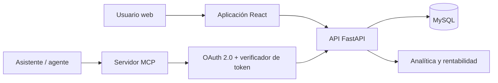

# Dedica

[← Volver al portfolio técnico](../README.md)

Sistema para registrar tiempo y gastos, administrar proyectos y consultar rentabilidad desde una interfaz web o mediante herramientas MCP.

| | |
| --- | --- |
| **Situación** | Herramienta privada |
| **Rol** | Diseño de producto, arquitectura y dirección técnica de extremo a extremo |
| **Stack** | FastAPI, React, MySQL, OAuth 2.0 y MCP |
| **Interfaces** | Aplicación web, API y servidor MCP |
| **Código** | Privado |

## Problema

Registrar dedicación suele convertirse en trabajo administrativo y los datos llegan tarde para decidir. Dedica unifica horas, gastos, tipos de trabajo y estado de proyectos, y permite operar sobre la misma información desde la web o desde un asistente compatible con MCP.

## Arquitectura

## Decisiones técnicas

### MCP como otra interfaz, no otro dominio

El servidor MCP reutiliza las mismas operaciones y restricciones del producto. No mantiene una segunda base de datos ni una lógica paralela para agentes.

### Herramientas pequeñas y explícitas

La implementación actual define 16 herramientas MCP agrupadas en consulta de proyectos y catálogos, alta de tiempo y gastos, mantenimiento de tipos, analítica y ciclo de vida de proyectos. Cada herramienta tiene un propósito acotado y parámetros definidos.

### OAuth para clientes remotos

El servidor publica metadatos de autorización y soporta código de autorización y renovación. Las credenciales del cliente, códigos y tokens se validan en el backend antes de permitir el acceso a las herramientas.

### Analítica calculada en servidor

La rentabilidad se deriva de dedicación, gastos y configuración del proyecto en una única capa de backend. La web y MCP consumen el mismo resultado y no reimplementan las fórmulas.

### Operaciones destructivas separadas

Cerrar, reabrir o eliminar un proyecto son acciones distintas de consultar o registrar tiempo. Mantenerlas como herramientas explícitas facilita aplicar autorización y pedir confirmación desde el cliente.

## Retos y soluciones

| Reto | Solución |
| --- | --- |
| Hacer útil MCP sin duplicar el producto | Adaptador MCP sobre el mismo backend y modelo de datos |
| Autorizar asistentes remotos | OAuth 2.0, verificación de token y validación de cliente |
| Evitar herramientas ambiguas con demasiadas funciones | Conjunto acotado de operaciones con entradas específicas |
| Mantener consistentes web, API y agentes | Reglas y cálculos centralizados en backend |
| Distinguir consulta de cambios sensibles | Herramientas separadas y autorización por operación |

## Resultado

Dedica permite que el registro y la consulta formen parte del flujo de trabajo del usuario, incluso desde un agente, sin perder una fuente única de datos. La implementación actual contiene 16 herramientas MCP; esta cifra describe el código, no garantiza que todas estén habilitadas en cada despliegue.

## Límites de esta documentación

No se publican clientes OAuth, tokens, endpoints privados, tarifas, datos de proyectos, identidad de usuarios ni código fuente.
