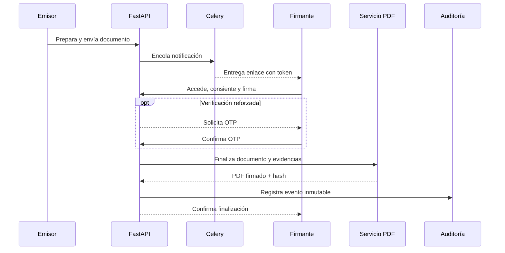

# FirmaYa

[← Volver al portfolio técnico](../README.md)

Plataforma para preparar, enviar y firmar documentos mediante firma electrónica simple, con trazabilidad del proceso.

| | |
| --- | --- |
| **Situación** | Producto privado |
| **Rol** | Diseño de producto, arquitectura y dirección técnica de extremo a extremo |
| **Stack** | FastAPI, React, TypeScript, MySQL, Redis, Celery, PyMuPDF y Docker |
| **Capacidades** | Enlace seguro, consentimiento, OTP opcional, firma manuscrita, QR y evidencias |
| **Código** | Privado |

## Problema

Una firma dibujada sobre un PDF no basta para construir un flujo fiable. Es necesario identificar el documento exacto, recoger consentimiento, controlar quién puede acceder, evitar finalizaciones duplicadas y conservar evidencias verificables.

FirmaYa coordina preparación, invitación, firma pública y generación de documentos sin presentar una firma simple como si fuera cualificada o certificada.

## Arquitectura

## Decisiones técnicas

### Alcance legal explícito

El producto implementa firma electrónica simple. La interfaz y la documentación evitan atribuirle propiedades de firma cualificada o certificada que requerirían otros prestadores, identidades y garantías.

### Acceso público mediante token

El firmante no necesita una cuenta interna. Un token de acceso limita el documento y el flujo disponibles, mientras el backend sigue comprobando estado, caducidad y operaciones permitidas.

### Integridad mediante hashes

Se calculan hashes SHA-256 para vincular el documento y sus evidencias con el contenido generado. El valor sirve para detectar cambios; no sustituye por sí solo una certificación externa.

### Finalización idempotente

La creación del PDF definitivo y del informe de evidencias se protege con bloqueo pesimista y comprobaciones de estado. Reintentar una petición no debe producir varias versiones finales.

### Auditoría append-only

Consentimiento, verificaciones y cambios relevantes se registran como eventos añadidos a la cronología, sin reescribir silenciosamente los anteriores.

## Retos y soluciones

| Reto | Solución |
| --- | --- |
| Permitir firma externa sin abrir el panel interno | Token específico, caducidad y permisos limitados |
| Evitar dos documentos finales ante peticiones concurrentes | Transacción, bloqueo y finalización idempotente |
| Conservar una historia comprensible del proceso | Eventos append-only e informe de evidencias |
| Añadir verificación sin hacerla obligatoria en todos los flujos | OTP configurable según el nivel necesario |
| Delimitar correctamente lo que ofrece el producto | Mensajes y arquitectura alineados con firma electrónica simple |

## Resultado

La solución cubre el recorrido completo desde la preparación hasta el PDF final y su informe de evidencias, manteniendo separados el panel del emisor, el acceso público del firmante, las notificaciones y el procesamiento documental.

## Límites de esta documentación

No se publican mecanismos de generación de tokens, plantillas, datos personales, documentos, secretos, endpoints internos ni código. Este caso no constituye asesoramiento legal.
