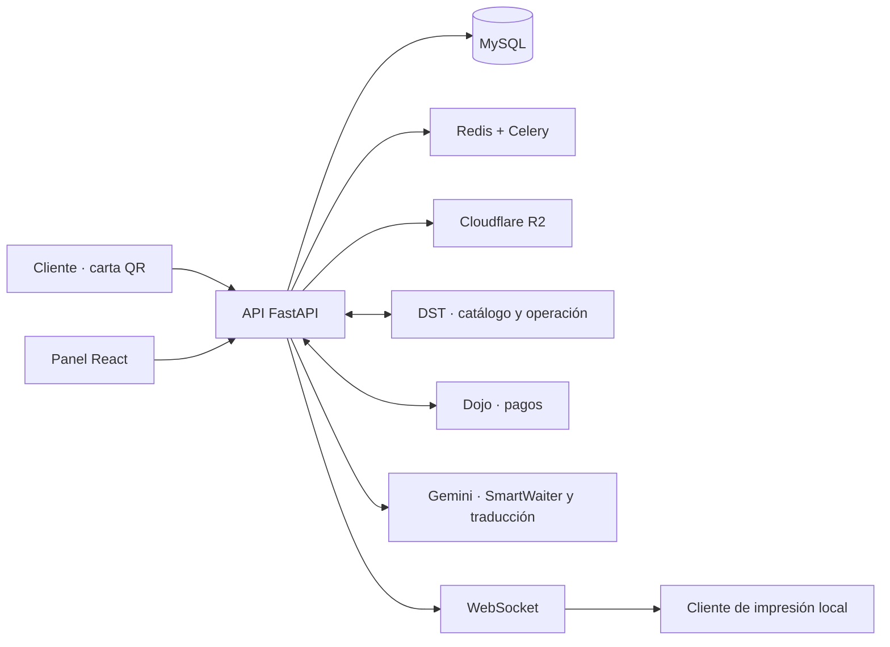

# MiCartaYa

[← Volver al portfolio técnico](../README.md)

SaaS para que un restaurante publique su carta mediante QR, reciba pedidos y gestione la operación en tiempo real desde un único panel.

| | |
| --- | --- |
| **Situación** | En producción en 14 restaurantes |
| **Rol** | Diseño de producto, arquitectura y dirección técnica de extremo a extremo |
| **Stack** | FastAPI, React, MySQL, Redis, Celery, Cloudflare R2 y Docker |
| **Integraciones** | DST, Dojo, Gemini, impresión local y WebSocket |
| **Código** | Privado |

## Problema

Una carta digital aislada resuelve poco. El reto real es conectar lo que ve el cliente con catálogo, disponibilidad, cobro, preparación e impresión, sin imponer al restaurante una operación paralela difícil de mantener.

MiCartaYa reúne carta pública, pedidos, administración y servicios externos, manteniendo separados los datos y la configuración de cada restaurante.

## Arquitectura

El diagrama muestra límites funcionales, no la topología interna ni los contratos privados.

## Decisiones técnicas

### El webhook confirma el pago

La vuelta del navegador mejora la experiencia, pero no es la autoridad sobre el cobro. El backend valida la firma HMAC del webhook de Dojo, registra el evento y separa el estado del pago del estado del pedido.

La materialización del pedido usa transiciones de estado controladas, deduplicación de eventos y bloqueo de la fila correspondiente. Así, dos notificaciones simultáneas no crean dos pedidos.

### La IA no inventa el catálogo

SmartWaiter usa Gemini para interpretar preferencias y recomendar, pero trabaja con identificadores de productos. El backend vuelve a resolver productos, precios y disponibilidad desde la base de datos antes de responder. También limita consultas fuera de contexto e incluye avisos específicos para alérgenos.

### Integraciones detrás de adaptadores

DST, Dojo, almacenamiento e IA se aíslan del dominio mediante servicios específicos. Esto permite distinguir fallos de autenticación, tiempo de espera o proveedor sin mezclar esos detalles con pedidos y cartas.

### Impresión como borde local

La plataforma envía eventos en tiempo real a un cliente instalado en el restaurante. El cliente local resuelve la impresora y el sistema operativo, mientras el servidor conserva el estado central del pedido.

## Retos y soluciones

| Reto | Solución |
| --- | --- |
| Evitar pedidos duplicados ante reintentos del proveedor de pagos | Webhooks firmados, identificador de evento, operación idempotente y bloqueo transaccional |
| Hacer útiles las recomendaciones sin ceder el control de los datos | Salida estructurada de IA y validación final contra catálogo y disponibilidad |
| Convivir con software instalado dentro del restaurante | Cliente de impresión desacoplado y comunicación WebSocket |
| Mantener aislados restaurantes, planes y funciones opcionales | Contexto de tenant y configuración por restaurante en backend |
| Traducir contenido sin convertir un proveedor en punto único de fallo | Procesamiento asíncrono y estrategia de fallback |

## Resultado

El producto opera en 14 restaurantes y admite funciones activables por cliente, como vídeo de producto, recomendaciones y traducción. La arquitectura permite evolucionar carta, pedido, pago e integraciones por separado sin exponer esos detalles al usuario final.

## Límites de esta documentación

No se publican contratos con proveedores, endpoints, credenciales, reglas comerciales, datos de restaurantes ni código fuente. Las capacidades descritas son una vista técnica deliberadamente reducida.
