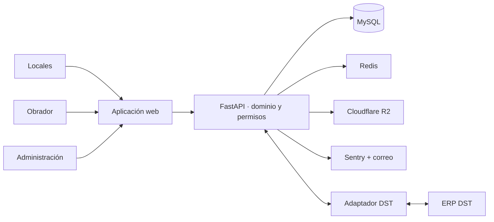
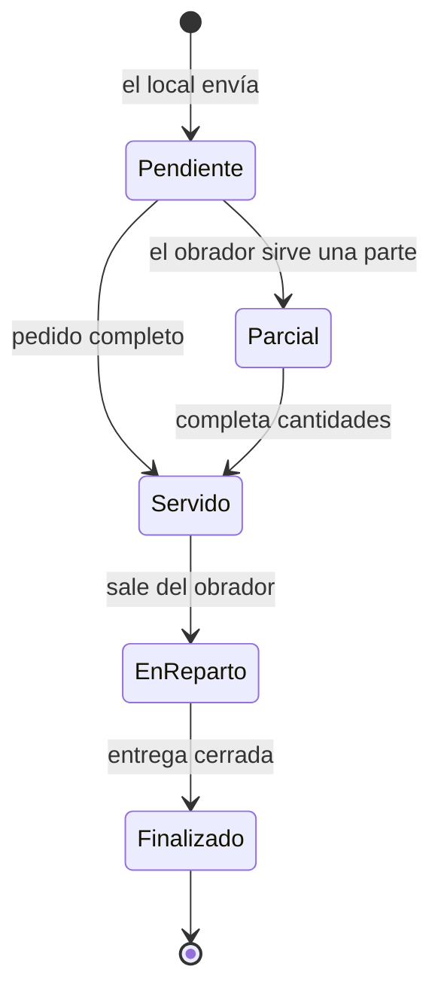

# OrderYa

[← Volver al portfolio técnico](../README.md)

Plataforma de pedidos entre un obrador central y sus locales, diseñada para hostelería y producción alimentaria con varios centros.

| | |
| --- | --- |
| **Situación** | En producción |
| **Rol** | Diseño de producto, arquitectura y dirección técnica de extremo a extremo |
| **Stack** | FastAPI, Jinja, Tailwind CSS, MySQL, Redis, Cloudflare R2 y Docker |
| **Integraciones** | DST, correo transaccional y Sentry |
| **Código** | Privado |

## Problema

Cuando varios locales piden a un mismo obrador, una lista de cantidades no basta. La operación necesita catálogo común, permisos distintos, fechas de servicio, estados de preparación, documentos y visibilidad económica, sin mezclar la información de empresas diferentes.

OrderYa digitaliza ese flujo y añade herramientas de previsión, inventario mínimo y rentabilidad para apoyar decisiones de producción.

## Alcance funcional

- Catálogo compartido de productos, familias y proveedores.
- Creación, edición y reutilización de pedidos mediante plantillas.
- Consola de obrador para consolidar, dividir por proveedor, servir y finalizar.
- Tratamiento de productos especiales, cantidades por peso o unidades y configuraciones de tartas.
- Sesiones de inventario y stock mínimo específico para cada local.
- Sugerencias de pedido construidas desde el histórico.
- Rentabilidad por producto, mes y temporada.
- Informes y exportaciones en PDF, Excel y CSV.
- Notificaciones transaccionales y registro de entregas de correo.

## Arquitectura

## Flujo operativo

El backend gobierna las transiciones y conserva el histórico. Local, obrador y administración obtienen vistas distintas del mismo pedido; no mantienen copias independientes.

La previsión usa consumos anteriores para sugerir cantidades, pero el local puede modificarlas antes de enviar. Inventario, stock mínimo y rentabilidad se apoyan en el mismo catálogo para evitar definiciones incompatibles entre módulos.

## Decisiones técnicas

### Tenant resuelto por subdominio

Cada empresa se identifica desde el subdominio y el backend aplica ese contexto a consultas y permisos. Los roles de administración, obrador y local expresan capacidades distintas; ocultar una opción en la interfaz no sustituye la autorización en la API.

### Sincronización DST con alcance explícito

El cliente de DST gestiona autenticación, renovación de acceso, tiempos de espera y errores del proveedor. La sincronización importa artículos y datos de catálogo, pero no envía pedidos ni descuenta existencias en DST. Esa frontera evita prometer una bidireccionalidad que el flujo actual no necesita.

### Previsión explicable

Las sugerencias se calculan a partir del histórico operativo y se presentan como ayuda, no como una orden automática ni como un modelo opaco. El usuario conserva el control sobre la cantidad final.

### Rentabilidad cerca de la operación

Costes, precios y cantidades se convierten en métricas por producto y periodo. Mantener estos cálculos en backend da una definición única a paneles y exportaciones.

## Operación y seguridad

- El contexto de empresa se resuelve al principio de la petición y se vuelve a comprobar en las consultas.
- Los permisos se aplican en servidor para superadministración, administración de empresa, obrador y local.
- Las credenciales de DST se descifran únicamente al realizar una comunicación con el proveedor.
- Redis soporta límites de uso y coordinación de procesos; Sentry centraliza errores operativos.
- Los documentos generados se abstraen detrás de un servicio de almacenamiento compatible con objetos.
- Las migraciones de base de datos forman parte del despliegue y los cambios del modelo se mantienen aditivos cuando deben convivir con datos existentes.

## Trade-offs

- La interfaz renderizada en servidor reduce la infraestructura del frontend, a cambio de acoplar más estrechamente vistas y rutas.
- La previsión se mantiene explicable y revisable; se renuncia a automatizar por completo una decisión de producción.
- DST se usa dentro de una frontera limitada. No replicar todas las funciones del ERP evita un acoplamiento bidireccional difícil de operar.

## Retos y soluciones

| Reto | Solución |
| --- | --- |
| Aislar varias empresas dentro de una misma aplicación | Resolución por subdominio, filtros de tenant y permisos en servidor |
| Integrarse con un ERP sin acoplar todo el producto | Cliente DST dedicado y frontera funcional documentada |
| Convertir históricos en una ayuda práctica | Sugerencias revisables con trazabilidad hacia los datos de origen |
| Dar vistas distintas a local, obrador y administración | Roles y estados de pedido modelados en el dominio |
| Mantener documentos y exportaciones fuera del servidor web | Almacenamiento de objetos y generación controlada desde backend |

## Resultado

OrderYa sustituye intercambios manuales por un flujo compartido entre locales y obrador. Sobre esa base incorpora previsión, rentabilidad e inventario sin convertir el ERP externo en una dependencia transversal.

## Límites de esta documentación

No se publican algoritmos de negocio, credenciales de DST, datos comerciales, direcciones internas, información de clientes ni código fuente.
