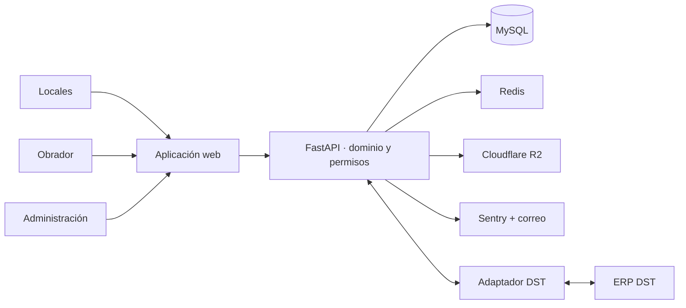

# OrderYa

[← Volver al portfolio técnico](../README.md)

Plataforma de pedidos entre un obrador central y sus locales, diseñada para hostelería y producción alimentaria con varios centros.

| | |
| --- | --- |
| **Situación** | En producción |
| **Rol** | Diseño de producto, arquitectura y dirección técnica de extremo a extremo |
| **Stack** | FastAPI, Jinja, Tailwind CSS, MySQL, Redis, Cloudflare R2 y Docker |
| **Integraciones** | DST, correo transaccional y Sentry |
| **Código** | Privado |

## Problema

Cuando varios locales piden a un mismo obrador, una lista de cantidades no basta. La operación necesita catálogo común, permisos distintos, fechas de servicio, estados de preparación, documentos y visibilidad económica, sin mezclar la información de empresas diferentes.

OrderYa digitaliza ese flujo y añade herramientas de previsión, inventario mínimo y rentabilidad para apoyar decisiones de producción.

## Arquitectura

## Decisiones técnicas

### Tenant resuelto por subdominio

Cada empresa se identifica desde el subdominio y el backend aplica ese contexto a consultas y permisos. Los roles de administración, obrador y local expresan capacidades distintas; ocultar una opción en la interfaz no sustituye la autorización en la API.

### Sincronización DST con alcance explícito

El cliente de DST gestiona autenticación, renovación de acceso, tiempos de espera y errores del proveedor. La sincronización importa artículos y datos de catálogo, pero no envía pedidos ni descuenta existencias en DST. Esa frontera evita prometer una bidireccionalidad que el flujo actual no necesita.

### Previsión explicable

Las sugerencias se calculan a partir del histórico operativo y se presentan como ayuda, no como una orden automática ni como un modelo opaco. El usuario conserva el control sobre la cantidad final.

### Rentabilidad cerca de la operación

Costes, precios y cantidades se convierten en métricas por producto y periodo. Mantener estos cálculos en backend da una definición única a paneles y exportaciones.

## Retos y soluciones

| Reto | Solución |
| --- | --- |
| Aislar varias empresas dentro de una misma aplicación | Resolución por subdominio, filtros de tenant y permisos en servidor |
| Integrarse con un ERP sin acoplar todo el producto | Cliente DST dedicado y frontera funcional documentada |
| Convertir históricos en una ayuda práctica | Sugerencias revisables con trazabilidad hacia los datos de origen |
| Dar vistas distintas a local, obrador y administración | Roles y estados de pedido modelados en el dominio |
| Mantener documentos y exportaciones fuera del servidor web | Almacenamiento de objetos y generación controlada desde backend |

## Resultado

OrderYa sustituye intercambios manuales por un flujo compartido entre locales y obrador. Sobre esa base incorpora previsión, rentabilidad e inventario sin convertir el ERP externo en una dependencia transversal.

## Límites de esta documentación

No se publican algoritmos de negocio, credenciales de DST, datos comerciales, direcciones internas, información de clientes ni código fuente.
