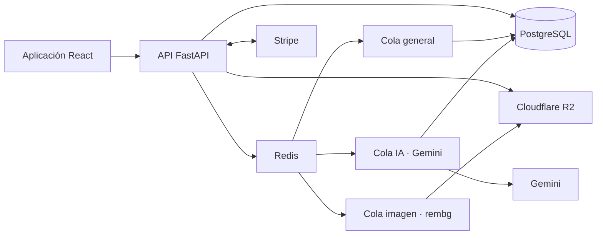

# Ponme

[← Volver al portfolio técnico](../README.md)

Producto de armario digital que procesa prendas y propone conjuntos mediante IA multimodal.

| | |
| --- | --- |
| **Situación** | En producción |
| **Rol** | Diseño de producto, arquitectura y dirección técnica de extremo a extremo |
| **Stack** | FastAPI, React, PostgreSQL, Redis, Celery, Gemini, rembg, Cloudflare R2 y Docker |
| **Integraciones** | Gemini, Stripe, Cloudflare R2 y Sentry |
| **Código** | Privado |

## Problema

Fotografiar una prenda es sencillo; convertirla en un elemento útil para recomendar un conjunto exige eliminar fondo, interpretar características visuales, almacenar el resultado y responder con una latencia razonable. Además, el producto debe controlar costes de IA y distinguir las capacidades gratuitas de las de pago.

## Arquitectura

## Decisiones técnicas

### Separar las colas por perfil de carga

Las tareas generales, el análisis con Gemini y el procesamiento de imagen se ejecutan en colas dedicadas. La separación evita que un trabajo intensivo en memoria bloquee operaciones breves y permite escalar coste y concurrencia de forma independiente.

### Salidas de IA estructuradas

Gemini interpreta imágenes y devuelve datos con una forma esperada. El backend valida esa salida antes de persistirla o usarla en recomendaciones; una respuesta del modelo no se trata como dato fiable por defecto.

### Almacenamiento de objetos con fallback local

Las imágenes procesadas viven en Cloudflare R2. Un modo local permite desarrollar y probar sin depender del proveedor, pero la aplicación conserva una única abstracción de almacenamiento.

### Stripe como autoridad de suscripción

Checkout inicia la compra y el portal permite gestionarla. El estado FREE/PRO se actualiza a partir de webhooks firmados, no solo desde una redirección del navegador.

### Coste antes de acceso

La verificación de email y los límites de uso se comprueban antes de encolar operaciones costosas. Así, una restricción de producto también protege recursos de IA y procesamiento.

## Retos y soluciones

| Reto | Solución |
| --- | --- |
| Procesar imagen e IA sin bloquear peticiones web | Celery y tres colas especializadas |
| Evitar que una salida variable contamine el dominio | Respuesta estructurada, validación y normalización en backend |
| Controlar el coste de funciones intensivas | Límites por plan y comprobaciones antes de encolar |
| Mantener sincronizado el acceso de pago | Webhooks firmados de Stripe y estado de suscripción persistido |
| Servir originales y derivados de forma eficiente | Almacenamiento de objetos y referencias persistentes |

## Resultado

Ponme convierte una captura en una prenda procesada y utilizable dentro del armario, y construye recomendaciones a partir de ese inventario. La arquitectura mantiene desacoplados experiencia web, procesamiento visual, modelo de IA y facturación.

## Límites de esta documentación

No se publican prompts, reglas de recomendación, límites comerciales, contratos de datos, credenciales, información de usuarios ni código fuente.
