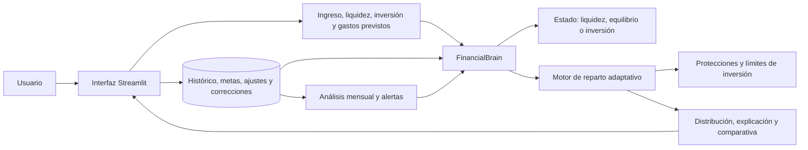

# TuParte

[← Volver al portfolio técnico](../README.md)

Herramienta personal de planificación financiera que propone cómo repartir un ingreso entre liquidez, objetivos, gastos e inversión según la situación real del usuario.

| | |
| --- | --- |
| **Situación** | Herramienta privada de uso personal |
| **Rol** | Diseño del modelo financiero, arquitectura e implementación dirigida |
| **Stack** | Python, Streamlit, pandas, Altair y persistencia local |
| **Dominio** | Reparto adaptativo, liquidez, inversión, colchón, metas y hábitos |
| **Código** | Privado |

## Problema

Un reparto fijo por porcentajes deja de ser útil cuando cambian los ingresos, aparecen gastos previstos, el colchón está incompleto o la relación entre liquidez e inversión se desequilibra.

TuParte transforma esas variables en una recomendación explicable. No se limita a visualizar saldos: evalúa el estado financiero, protege mínimos, adapta los pesos y muestra qué habría ocurrido sin aplicar la adaptación.

## Alcance funcional

- Registro de ingresos y distribución entre pockets de gasto, ahorro e inversión.
- Lectura conjunta de liquidez disponible, inversión acumulada y aporte fijo.
- Incorporación de gastos previstos antes de calcular el reparto.
- Metas vinculadas a una categoría, con colchón adicional, progreso y prioridad.
- Aportaciones, retiradas, ajustes y correcciones sin borrar el histórico.
- Alertas descartables para pockets bajos y situaciones de inversión elevada.
- Comparación entre plan base y plan adaptativo.
- Panel mensual con indicadores, evolución y visualizaciones.
- Persistencia local sin conexión ni acceso automático a cuentas bancarias.

## Arquitectura

## Cómo funciona el motor

### Lectura del punto de partida

El cálculo combina el nuevo ingreso con la liquidez disponible, la inversión acumulada, el aporte fijo deseado, los gastos ya conocidos y los saldos de cada pocket. A partir de la relación entre efectivo e inversión selecciona un estado de liquidez, equilibrio o inversión.

### Safety score financiero

El motor calcula un factor defensivo a partir de varias señales:

- Déficit respecto a la liquidez objetivo.
- Distancia hasta el colchón de emergencia.
- Presión de gastos previstos sobre el ingreso.
- Peso de los compromisos esenciales.
- Retiradas recientes de ahorro.

Estas señales se combinan en una puntuación que decide cuánto debe protegerse el reparto. Los umbrales son configurables para poder ajustar el modelo sin reescribir su lógica.

### Distribución adaptativa

El reparto comienza con objetivos y pesos configurados, pero puede modificarlos cuando detecta riesgo. Entre otras acciones:

- Refuerza pockets con saldo anormalmente bajo.
- Prioriza ahorro cuando el colchón o la liquidez están por debajo del objetivo.
- Reduce la inversión variable tras varios periodos de liquidez ajustada.
- Limita inversión extra y total en estados defensivos.
- Redirige hacia ahorro el importe que supera esos límites.
- Protege o ajusta el aporte fijo según la presión financiera.
- Considera metas cercanas a completarse sin obligar a priorizarlas.

El usuario puede descartar una alerta concreta y conservar el reparto base para ese pocket.

### Comparación antes de decidir

TuParte ejecuta el cálculo dos veces: una distribución base y otra con adaptación. La interfaz muestra las diferencias, los pesos efectivos, los límites aplicados y una estimación del tiempo necesario para recuperar liquidez o colchón.

El resultado sigue siendo editable. Antes de guardar, la aplicación verifica si la suma coincide con el ingreso y señala dinero pendiente o exceso de asignación.

## Análisis histórico

El histórico se agrupa por mes para calcular ingresos, inversión, ocio y ratio de liquidez. Sobre esos datos se detectan:

- Periodos consecutivos con liquidez baja.
- Pockets que permanecen por debajo de su nivel habitual.
- Evolución mensual de la liquidez.
- Relación entre ingresos y porcentaje invertido.
- Concentración del saldo entre pockets.
- Metas activas y progreso acumulado.

Los datos de entrada se normalizan antes de calcular: se migran nombres antiguos, se añaden columnas ausentes, se convierten importes y se aplican ajustes o correcciones sin perder el registro original.

## Decisiones técnicas

### Reglas deterministas en lugar de IA generativa

Una recomendación financiera debe poder explicarse y repetirse con los mismos datos. El motor usa fórmulas, umbrales y estados explícitos; no delega el reparto a un modelo generativo.

### Baseline y adaptación separados

Calcular ambos escenarios permite medir el efecto real de cada protección. También evita presentar una recomendación modificada sin explicar de dónde viene la diferencia.

### Configuración sin dispersar lógica

Objetivos, ratios y límites se cargan desde configuración, mientras la composición de métricas y decisiones permanece centralizada en `FinancialBrain`.

### Persistencia local y tolerante a cambios

El producto no necesita acceso bancario. Mantiene históricos, metas y correcciones en archivos locales, con normalización y recuperación ante filas defectuosas o esquemas anteriores.

### Control final del usuario

Las alertas pueden descartarse, las cantidades pueden editarse y el reparto debe cuadrar antes de guardarse. El motor aconseja; no mueve dinero ni ejecuta operaciones financieras.

## Casos límite y consistencia

- Los importes negativos se normalizan antes de entrar en ratios y puntuaciones.
- Los cocientes con liquidez o inversión cero producen estados controlados, no divisiones inválidas.
- Cada factor del safety score se limita a un rango conocido antes de combinarse.
- Los pesos se normalizan; si la configuración suma cero, se aplica una distribución uniforme segura.
- Las filas CSV defectuosas se omiten y quedan registradas como advertencia.
- Los nombres antiguos de pockets se migran durante la lectura.
- Las columnas ausentes se completan para conservar compatibilidad con históricos anteriores.
- El editor final detecta tanto dinero sin asignar como una distribución superior al ingreso.

## Retos y soluciones

| Reto | Solución |
| --- | --- |
| Adaptar porcentajes sin generar resultados arbitrarios | Estados explícitos, métricas normalizadas y reglas deterministas |
| Equilibrar inversión con seguridad financiera | Safety score, colchón objetivo y límites proporcionales |
| Explicar por qué cambia una recomendación | Comparación base/adaptativa, motivos y pesos efectivos |
| Aprender del histórico sin sobreajustar | Agregación mensual, alertas simples y umbrales configurables |
| Evolucionar las categorías sin romper datos anteriores | Renombrado, columnas por defecto, ajustes y correcciones |
| Conservar autonomía del usuario | Edición manual, descarte de alertas y validación del total |

## Resultado

TuParte convierte un conjunto de saldos y objetivos en una decisión mensual trazable. La complejidad está concentrada en un motor financiero que distingue seguridad, liquidez e inversión, incorpora señales del histórico y explica cada adaptación antes de que el usuario la acepte.

## Límites de esta documentación

No se publican importes personales, históricos, objetivos reales, parámetros privados ni el código del algoritmo. TuParte es una herramienta de planificación personal y no presta asesoramiento financiero.
